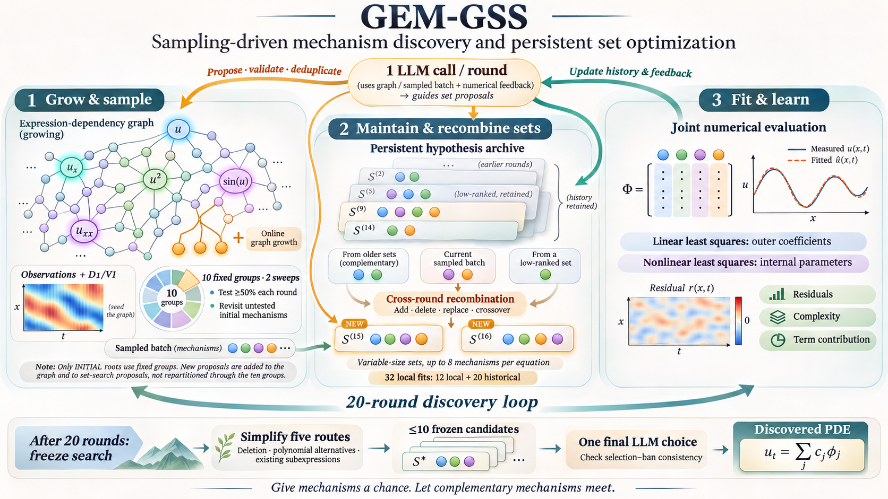

# GEM-GSS

**Sampling-driven mechanism discovery and persistent PDE set optimization.**

GEM-GSS discovers a variable-size set of mechanisms on a growing expression graph.
It combines coverage-driven sampling, one LLM decision per round, joint numerical
fitting, cross-round historical recombination, and one terminal model selection.



[中文说明](README.zh-CN.md) · [Method](docs/METHOD.md) · [Recorded results](docs/RESULTS.md) · [Sources](THIRD_PARTY_NOTICES.md)

## Install

CPU only; Python 3.12 or later. No PyTorch or local LLM required.

```bash
python -m venv .venv
# Linux/macOS: source .venv/bin/activate
# PowerShell: .venv/Scripts/Activate.ps1
python -m pip install -e .
```

For the recorded numerical versions, install `requirements-repro.txt` before
`pip install -e .`. All six observation-only datasets, original initial graph
snapshots, cached seed proposals, and the local tokenizer are bundled. No old
experiment directory, Windows path, or model download is needed.

## First run: offline checks

```bash
python -m gem_gss list
python -m gem_gss doctor
python -m gem_gss doctor --verify-results
python -m unittest discover -s tests -v
```

`doctor --verify-results` recomputes predictions of the recorded equations; it
does not fit parameters or call an API. Tests also run a synthetic 20-round
search, checkpoint reuse and final selection with a **mocked** provider. They
do not demonstrate the accuracy of a new live LLM search.

## Discover a PDE with your provider

Supply an OpenAI-compatible chat-completions endpoint and model explicitly:

```bash
export GEM_GSS_API_KEY="your-key"
export GEM_GSS_BASE_URL="https://your-endpoint/v1"
export GEM_GSS_MODEL="your-model"
python -m gem_gss run --case T01 --output runs/standard
```

PowerShell:

```powershell
$env:GEM_GSS_API_KEY = "your-key"
$env:GEM_GSS_BASE_URL = "https://your-endpoint/v1"
$env:GEM_GSS_MODEL = "your-model"
python -m gem_gss run --case T01 --output runs/standard
```

Supported case IDs: `T01 T02 T03 T04 T05 T2D`. Run cases in separate processes.
The original provider alias was `deepseek-flash-1017`, returning
`deepseek-v4-1-flash-261017`; aliases depend on the provider. The bundled tokenizer
is the original DeepSeek tokenizer: with other models its input-token counts are
an audit convention, not exact provider billing. Providers must support the
chat request fields used in `gem_gss/api.py`, including the original
`thinking={"type":"disabled"}` field, or ignore that field.

The standard run makes **20 search requests + 1 final request** using cached
initial graphs. Search outputs allow up to 20,000 tokens; search inputs can be
large. Failed search policies use the logged quota-repair path; no automatic
extra HTTP request is made. Invalid final selection/ban consistency stops the
run without silently changing the selected model.

Repeat the exact command to resume. Request/checkpoint files prevent resending
an already reserved round. If a process is killed, `run.lock` is deliberately
left in place: verify no worker is active before removing that one lock file.
Changed code/configuration requires a separate output directory.

Use `--search-only` to stop after discovery and freeze the archive. Running the
same command later without `--search-only` completes the terminal stage. The
default 2D backend uses the guarded derivative/window fusion; use
`--reference-numerics` from the beginning of a separate run to use original
operators. 1D always uses the original numerical path.

## Graph construction and optional fresh initialization

```bash
# Rebuild with original cached L0/G0 proposals and the uniform graph rules:
python -m gem_gss build-graph --case T01 --output graph.json

# Optional: one separately logged live initialization request:
python -m gem_gss initialize --case T01 --output initialization/T01
python -m gem_gss build-graph --case T01 \
  --seeds initialization/T01/seed_proposals.json --output graph.json
python -m gem_gss run --case T01 --graph graph.json --output runs/new_graph
```

The default run loads the supplied frozen graph. A graph rebuilt with another
library version can have different ordering/IDs; it is a separate graph input,
not a promise of a byte-identical historical snapshot. Graph construction and
deduplication do not fit observations or read reference equations.

Custom 1D/2D cases can use `--case-json examples/custom_case.json` instead of
`--case`. Supply an observation-only NPZ, weak description, metadata, and graph
snapshot (or a seed-proposal JSON when building the graph). Paths in the custom
JSON are relative to that file. The release does **not** claim validated 3D
discovery.

## Ablation factors

```bash
python -m gem_gss run --case T03 --ablation A --output runs/A
python -m gem_gss run --case T03 --ablation B --output runs/B
python -m gem_gss run --case T03 --ablation AB --output runs/AB
```

- **A:** omit one-hop neighbor rows and edges from LLM input; preserve sampled,
  active and history-preview expressions and all program-side graph operations.
- **B:** reduce mandatory testing from half to one quarter per round; full
  initial-root coverage is no longer guaranteed.
- **AB:** both changes. Local fitting budget remains 12 ordinary + 20 historical.

All release variants use the **latest** terminal core-refinement module. Recorded
T03 ablations predated that extension and are supplied as historical results,
not falsely presented as reruns of this cleaned release.

## Evaluate only after final selection

```bash
python -m gem_gss evaluate --case T01 \
  --result runs/standard/T01/final_result.json
```

This explicit command reads `assets/evaluation_references.json` and reports
expanded-support Jaccard and true-term recovery. Discovery, fitting and terminal
selection never import the evaluator or load that file. Recorded equations are
likewise loaded only by the explicit offline verification command.

## Repository layout

```text
gem_gss/
  cli.py                       # entry points, config, optional ablation factors
  grammar.py, builder.py,
  constructors.py,
  deduplicate.py, profile_rules.py  # finite graph and domain-aware aliases
  core.py, fitting.py,
  fused_numerics.py             # observations, variable projection, 2D backend
  graph.py, memory.py,
  rotation.py, recombine.py,
  search.py                    # online growth, archives and set-search loop
  api.py, compression.py,
  policy_adapter.py            # API accounting and fixed pre-dispatch encoding
  refinement.py, terminal.py,
  structure.py, evaluation.py  # terminal selection and separate evaluation
  assets/                      # six observations, graphs, tokenizer and records
docs/                          # method, results and diagram
tests/                         # offline numerical and integration checks
```

The cleaned package consolidates the old terminal selectors/pruners into
`terminal.py` and `refinement.py`, merges crossover into `recombine.py`, and
removes historical workers, temporary experiments, raw API transcripts and
credentials. No code was uploaded to GitHub automatically; this directory is
the repository root to upload. See `release_manifest.json` for the audited file
count, hashes, package size and checks.

## Evidence scope

Recorded final structural Jaccard is 1 on all six development cases. This includes
the authorized T05 terminal-rule extension and re-selection; it is not a blind
benchmark or a fresh live reproduction of this release. MSE is an all-observation
spatial-window residual, not held-out prediction error. Repeated-seed, noise and
unseen-equation generalization remain unverified. See [results](docs/RESULTS.md).

The numerical layer follows the weighted-window PDE-discovery setting of
[LLM-PDESR](https://arxiv.org/abs/2607.10546). The set-based viewpoint is inspired
by [GraphComBO](https://arxiv.org/abs/2405.15119); this implementation is **not**
GraphComBO's Bayesian optimizer. Variable projection uses linear least squares
for external coefficients and bounded nonlinear least squares for internal
parameters. No guarantee of a global structural or nonlinear optimum is made.

Source, tokenizer and data attribution are preserved in
[THIRD_PARTY_NOTICES.md](THIRD_PARTY_NOTICES.md); no blanket license is invented
for mixed-origin materials.
