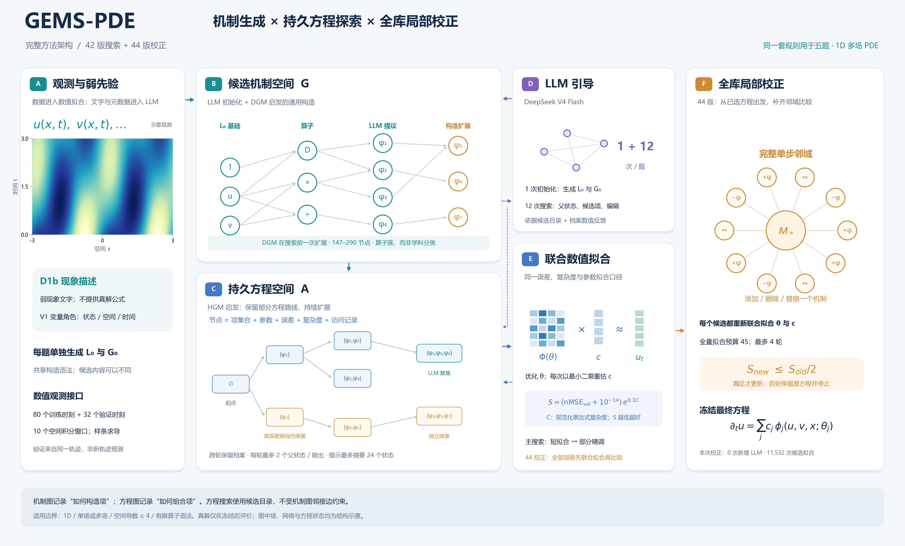

# GEMS-PDE 与适配版 LLM-PDESR 基线

一个可独立运行的 1D PDE 发现实验包，包含：

- **GEMS-PDE 最新方法**：LLM 初始化机制库 → 通用构造扩展 → 持久方程档案搜索 → 完整单步邻域联合拟合校正。
- **LLM-PDESR 基线**：保留原 ExperienceBuffer/Pareto 提示核心，每题生成 100 个 LLM 方程返回，使用共同的数值拟合与复杂度口径。
- 五题观测数据、D1b/V1 弱先验、已保存结果与 API 记录，以及冻结后评价程序。

本文件夹就是仓库根目录。运行不依赖原项目的 01/26/38/39/42/44 等历史目录。仅需 CPU，无需 PyTorch、GPU 或本地模型服务。第三方代码和数据来源说明见 [THIRD_PARTY_NOTICES.md](THIRD_PARTY_NOTICES.md)。



图中文字为历史默认预算。完整图下载：[SVG](assets/gems_pde_architecture.svg) / [PDF](assets/gems_pde_architecture.pdf)。

## 1. 安装

本地检查环境为 **Python 3.12.7**；建议使用 Python 3.12。

```bash
python -m venv .venv
# Windows PowerShell:
.venv/Scripts/Activate.ps1
# Linux/macOS 改为：source .venv/bin/activate
python -m pip install -e .
```

若要使用历史计算环境的数值库版本：

```bash
python -m pip install -r requirements-repro.txt
python -m pip install -e . --no-deps
```

普通依赖范围见 `requirements.txt`；两者选择其一即可。源码检出后在仓库根目录运行 `python -m gems_pde` 也可使用，不强制安装 editable 包。

## 2. 先离线检查，不调用 API

```bash
python -m gems_pde list-tasks
python -m gems_pde doctor
python -m unittest discover -s tests -v
python -m gems_pde audit-published --offline --check-mse
```

最后一条命令校验打包文件哈希，使用保存的方程与系数重算残差，并在确认全部冻结结果存在后重新计算 Jaccard。**它不重新搜索、不重新拟合参数、不访问 LLM API。** 输出默认在 `runs/published_audit/`。

测试中的端到端运行使用小型合成数据、缩小预算和模拟 LLM 回复，实际执行数值拟合、档案搜索、局部校正、基线、恢复和评价。它不代替新的真实 LLM 实验。

本次整理已通过 13 项离线测试、18 个输出残差核对和全部 11,532 条校正候选记录核对；安装包也已在临时目录独立安装并读取全部五题数据。详见 [机器可读检查记录](artifacts/validation_summary.json)。

## 3. 配置 API

复制 `.env.example` 为仓库根目录的 `.env`，填写自己的配置：

```dotenv
PDE_API_KEY=your_key
PDE_API_BASE_URL=https://api.teamorouter.cn/v1
PDE_MODEL=deepseek-v4-flash
PDE_THINKING=disabled
```

也可通过系统环境变量设置。客户端使用 OpenAI-compatible `/chat/completions` 接口；`thinking` 是提供商扩展，不支持时将 `PDE_THINKING` 设为空。历史返回模型 ID 为 `deepseek-v4-flash-ga-260731`，现在实际返回的模型由服务端决定。程序不会读取父目录旧项目的 `.env`。

`.env`、新实验 `runs/` 和缓存目录已加入 `.gitignore`。代码不记录 API key。`--offline` 在缓存缺失时直接报错，不会退回在线请求。

## 4. 完整运行流程

### 分阶段运行五题

```bash
# 每题：1 次机制初始化 + 12 次 LLM 搜索引导
python -m gems_pde search --tasks all --run-dir runs/main

# 从上一步方程出发；0 次新增 LLM，增加数值计算
python -m gems_pde refine --tasks all --run-dir runs/main

# 每题 100 次 LLM 方程返回；初始种子方程不计入 100
python -m gems_pde baseline --tasks all --run-dir runs/main

# 只有全部所选任务的最新方法、基线均冻结后才解析真解
python -m gems_pde evaluate --tasks all --run-dir runs/main --references artifacts/references.json --output-dir runs/main/evaluation

python -m gems_pde usage --run-dir runs/main
```

一次执行搜索、校正和基线三个阶段：

```bash
python -m gems_pde run --tasks all --run-dir runs/main
```

`run` 会执行真实 API 请求：默认五题计划 **65 次方法成功返回 + 500 次基线成功返回**。传输失败、JSON 格式失败等重试可能增加实际请求数；尝试记录单独保存。

### 先运行一题

```bash
python -m gems_pde run --tasks T01 --run-dir runs/one
python -m gems_pde evaluate --tasks T01 --run-dir runs/one --references artifacts/references.json --output-dir runs/one/evaluation
```

### 仅重跑历史起点的数值校正

```bash
python -m gems_pde refine --tasks all --run-dir runs/correction_replay --source-dir artifacts/published/proposed42 --offline
```

这会重新计算完整邻域，不调用 API；历史本机批次约 28.1 分钟，仅供估算，当前机器/依赖版本可能不同。这与 `audit-published` 仅核对已保存结果有区别。若要进一步和基线比较，可使用 `evaluate`，但该命令要求同一输入目录中已存在对应基线冻结结果。

### 恢复

重复同一命令会读取阶段检查点和缓存，已冻结阶段直接返回。恢复时会核对代码、配置、数据、先验、数值库版本和校正起点哈希；有变化时请使用新的 `--run-dir`。历史发布快照没有新版恢复协议，不能直接作为新在线搜索输出目录；只能审计或作为 `refine --source-dir` 输入。

默认顺序执行任务，每个进程将 BLAS 线程数设为 1。可在不同进程运行不同任务，不要同时写同一个阶段、同一个任务目录。

## 5. 代码结构

```text
.
├── gems_pde/
│   ├── cli.py                 # 统一命令入口
│   ├── config.py              # 共享历史默认预算、任务和环境变量
│   ├── api.py                 # 请求、精确缓存、离线模式、尝试与 usage 日志
│   ├── run_guard.py           # 恢复时的来源/配置/数据校验
│   ├── mechanisms.py          # 表达式语法和搜索前通用机制构造
│   ├── observations.py        # 数据、时间划分、样条和空间窗口
│   ├── common.py              # 规范化复杂度、变量投影、最终系数重拟合
│   ├── search.py              # 持久方程档案、LLM/独立选父状态、局部编辑
│   ├── refine.py              # 完整单步邻域校正
│   ├── baseline_adapter.py    # 基线生成函数的 AST 解析，不执行生成函数
│   ├── baseline.py            # 100 返回基线，复用共同拟合器
│   ├── scoring.py             # 仅供冻结后使用的结构 Jaccard
│   ├── evaluation.py          # 冻结检查、对比表、残差重算和 usage 汇总
│   ├── vendor/llmpdesr/       # 原 Pareto buffer、代码解析及轻量配置
│   └── resources/             # 五题 tasks.json、弱先验和观测 .mat
├── artifacts/
│   ├── published/             # 历史冻结结果、候选档案与 API/拟合记录
│   │   ├── proposed42/        # 原 42 搜索及后续校正起点
│   │   ├── proposed/          # 最新 44 校正结果
│   │   └── baseline_100/      # 每题 100 返回的适配基线
│   ├── references.json        # 仅评价命令读取，不进入搜索
│   ├── reported_comparison.json
│   ├── final_equations.txt
│   ├── source_provenance.json # 历史来源相对路径与哈希
│   └── release_manifest.json  # 发布时文件哈希
├── docs/                      # 详细架构、数值口径、复现与检查说明
├── assets/                    # 方法图、资源核对数据
├── tests/                     # 离线单元及小型端到端检查
└── .github/workflows/         # 无 API 的 CI 配置
```

详细说明：[代码架构](docs/ARCHITECTURE.md) · [数值拟合与基线区别](docs/NUMERICS.md) · [复现与局限](docs/REPRODUCIBILITY.md) · [代码检查记录](docs/CODE_REVIEW.md)。

## 6. 已保存的五题结果

| 任务 | 最新 MSE | 最新 Jaccard | 42 Jaccard | 基线 Jaccard |
|---|---:|---:|---:|---:|
| T01 Topography | 1.26146e-12 | 1.0000 | 1.0000 | 0.4286 |
| T02 Morphogenesis | 1.55988e-14 | 1.0000 | 1.0000 | 0.3333 |
| T03 Swift–Hohenberg | 1.86970e-08 | 0.7143 | 0.7143 | 0.2857 |
| T04 Traffic | 8.25974e-13 | 0.8333 | 0.5000 | 0.0909 |
| T05 Predator–Prey | 3.32032e-13 | 0.6667 | 0.3333 | 0.6667 |
| **五题平均 Jaccard** | — | **0.842857** | **0.709524** | **0.361039** |
| **合并交并比** | — | **0.804878** | **0.600000** | **0.351351** |

MSE 为全部观测时刻、十个空间窗口上的积分残差；双输出取平均。它不是独立初值轨迹上的预测 MSE。完整方程见 [final_equations.txt](artifacts/final_equations.txt)。

历史当前方法路径继承 65 次成功返回、758,913 token；基线为 500 次、491,239 token。调用数少 87%，但总 token 多约 54.5%。最新校正增加 11,532 次候选联合拟合，**不属于等计算预算比较**。历史 usage 只统计成功保存返回；新版客户端额外保留每次尝试的状态与可获得的 usage。


