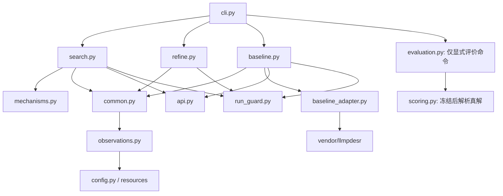

# 代码架构与阶段接口

## 1. 入口与依赖方向

统一入口是 `python -m gems_pde COMMAND` 或安装后的 `gems-pde COMMAND`。



`search`、`baseline`、`refine`、`common` 不导入评价模块。`artifacts/references.json` 不是任何发现命令的参数。代码哈希只对 Python 源文件计算，不会把真解内容并入提示。

## 2. 共享数值层

`observations.Data` 从任务定义的 .mat 中读取 `x,t,u` 和可选 `v`。默认取 80 个训练、32 个验证时刻，计算时间样条导数、窗口矩阵及目标向量。

`common.Data.feature` 计算表达式的数值列，并缓存场导数与参数化特征。`common.fit` 对给定项集合进行变量投影；`common.complexity` 计算规范化复杂度；`common.final_equation` 在结构和内部参数固定后重拟合全部时刻的外层系数。

三种搜索阶段都使用上述代码。基线通过 `shared=True` 保留同一输出中重复使用的内部参数；方法的节点参数默认独立。主搜索还会传入父状态参数作为初值。

## 3. 持久档案搜索

每题 `search.run(index)`：

1. 校验或写入 `run_protocol.json`。
2. 一次 LLM 初始化 L0/G0，规范化和合并重复节点。
3. `mechanisms.grow_graph` 用相同构造规则扩展，构造数值有效候选目录。
4. 每个输出建立独立 `Archive`，空结构为根状态。
5. 每轮从档案选取摘要，让 LLM 选择焦点、优先机制和编辑；另选一个独立探索父状态。
6. 每个父状态最多生成 20 个编辑候选；全部先短拟合，有限结果入档；得分和多样性共同选取至多 6 个完整精调。
7. 保存档案、状态图、随机数状态和历史。最终精调与删除检查后冻结。

Archive 的键是排序后的机制 ID 集合。同一结构只保留最佳已知参数拟合，但其父编辑关系可持续增加。高误差状态不会仅因不是当前最优而被删除；有限预算仍不保证每条路线最终都被扩展。

默认 LLM 每题 1+12 次成功返回，Predator–Prey 两个输出共享这题的引导调用。不是每个输出单独 13 次。

## 4. 完整单步邻域校正

`refine.run(index,source_dir)` 读取来源任务目录的：

- `constructible_graph.json`：可用机制；
- `equation_archive.json`：被选状态及其训练参数；
- `frozen_result.json`：未接受修改时保留原最终方程。

默认来源为当前运行的 `proposed42/Txx`。也可显式指定发布快照 `artifacts/published/proposed42`。

每轮枚举所有合法的一次增、删、替换；所有候选都用完整预算联合拟合，再按原得分排序。要求二倍得分改进，最多四轮。每轮 `candidates/u_sweepNN.jsonl` 首行为来源与候选目录头信息，后面逐条保存拟合结果。重启时按头信息核对并复用完整记录。

该阶段不调用 API，不扩展机制图，也不从全部档案父状态重新开始。`full_budget` 表示相同的有限精调预算，不表示数学上求到了全局参数最优。

## 5. 基线接口

`baseline.run(index)` 通过原 Pareto buffer 获取提示，让 LLM 返回完整 `equation` 函数。`baseline_adapter.extract` 只解析 AST，展开局部数学赋值和顶层加法，将外部系数分组；不执行生成函数，不允许导入、循环或任意程序逻辑。

随后调用 `common.fit(..., shared=True, full_budget=True)`。训练误差与复杂度更新 Pareto 前沿，最后以共同验证得分选择最终候选。每题 100 个返回，无效数学候选也占样本；额外的 1 个种子方程不计入 100。

## 6. 输出契约

| 目录 | 含义 |
|---|---|
| `RUN/proposed42/Txx` | LLM 初始化与持久档案搜索 |
| `RUN/proposed/Txx` | 最新校正后方法 |
| `RUN/baseline_100/Txx` | 完整方程生成基线 |
| `RUN/.../run_protocol.json` | 代码、数据、先验、配置、数值环境的哈希/标识 |
| `RUN/.../api` | 请求参数（无 key）、提示、返回、usage 和尝试记录 |
| `RUN/.../frozen_result.json` | 已固定方程、参数、系数与 MSE |

`evaluate` 默认要求最新方法与基线在全部所选任务均冻结；若原搜索冻结结果也齐全，会额外评价 `proposed42`。所有冻结文件先检查，再解析参考方程，完成后再次核对冻结文件哈希。

## 7. 增加自己的 1D 任务

准备 `.mat`：`x` 与 `t` 严格递增，`x` 均匀，至少六个空间样本，`u` / 可选 `v` 的形状为 `(nx,nt)`。默认 112 个抽样时刻及端点排除要求足够长的时间轴；数据不足会明确报错。

准备纯弱先验 `prior.txt` 和任务 JSON，例如：

```json
[
  {"id":"CUSTOM","name":"my_observation","data":"data.mat","prior":"prior.txt"}
]
```

路径相对这个 JSON 解析，不相对当前工作目录。

```bash
python -m gems_pde run --tasks-file my_task/tasks.json --tasks CUSTOM --run-dir runs/custom
```

默认 grammar 支持 `u,v,x`，不是任意数量任意命名字段。增加其他字段或高维空间需要扩展表达式与数值层。自有任务的参考方程放在单独 JSON，只交给 `evaluate --references ...`。
